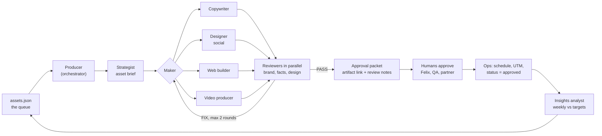

# Plan: an agentic marketing repo

Status: Phase 0 built, 15 Nov 2026 (see Rollout). Phases 1–3 are a proposal.

## Where we are

The repo can already make most assets, but a person drives every step.

| Have | Gap |
|---|---|
| 7 `axmed-*` skills (post, email, carousel, WhatsApp card, video brief, voice-over, asset multiplier) | Each one runs by hand, one at a time |
| `brand-reviewer` agent | The only independent check. Numbers, design and claims are checked by the same session that wrote them |
| `strategy/campaigns/01-every-birth/asset-plan.md` | Status is an emoji column edited by hand; no agent can read it reliably |
| Brand kit, tokens, templates, render scripts | Not tied to a review step; nothing stops an off-kit asset |
| ElevenLabs MCP | No data connection back from LinkedIn or HubSpot, so nobody measures against `strategy/measurement.md` |

## The idea in one line

A **producer** takes an asset ID from the plan, briefs the right **maker**, sends the draft to
**independent reviewers**, loops until they pass, and hands a ready-to-approve packet to a
**human**. Agents never post, send or publish. People approve and press the button.



## Who we need

### Agents (in `.claude/agents/`)

Each agent has one job, the fewest tools that job needs, and a fixed output format. Makers write;
reviewers only read. A reviewer never sees the maker's reasoning, only the files.

| Agent | Job | Reads | Writes | Tools | Model |
|---|---|---|---|---|---|
| **Producer** (main session, via the `/produce` skill) | Picks the asset, runs the pipeline, keeps status | `assets.json`, briefs, reviews | `assets.json`, approval packet | Agent, Read, Edit, Artifact | Opus |
| **Strategist** | Turns a plan row into an asset brief: audience, one message, CTA, numbers needed, format, references | campaign brief, fact sheet, positioning, `sina-and-ai.md` | `brief.md` | Read, Write | Opus |
| **Copywriter** | Posts, emails, captions, scripts, card text, through the existing skills | brief, guidelines, voice | `copy.md` | Read, Write, Skill | Sonnet |
| **Designer** | Carousels, cards, infographics from the brand kit; renders PNG/PDF | brief, copy, `brand/kit`, templates | `slides.html`, renders | Read, Write, Edit, Bash (render only) | Sonnet |
| **Web builder** | Sections and pages in `site/`, side-page build, lint | brief, `WEB-DESIGN.md`, site | `site/` | Read, Write, Edit, Bash, browser preview | Opus |
| **Video producer** | Storyboard, Remotion scenes, narrator VO and captions | brief, video skills | `video/`, audio | Read, Write, Bash, ElevenLabs MCP | Sonnet |
| **Brand reviewer** (exists) | Voice, creative rules, central test | guidelines, asset | `review.md` | Read, Grep, Glob | Opus |
| **Fact checker** (new) | Every number letter-for-letter against the fact sheet; every AI claim against `sina-and-ai.md`; CTA and UTM present; consent on file for any named person | fact sheet, consent records, asset | `review.md` | Read, Grep, Bash (`check-numbers` script) | Sonnet |
| **Design reviewer** (new) | Kit rules, Hallmark lint, screenshots at every size, contrast, text overflow | kit, renders | `review.md` | Read, Bash (lint, screenshot) | Sonnet |
| **Ops** (new) | UTM links, file names, `assets.json` status, `ASSETS.md`, kit rebuild, scheduling sheet | everything | status files only | Read, Edit, Bash | Haiku |
| **Insights analyst** (phase 3) | Weekly read of LinkedIn and HubSpot results against `measurement.md`; feeds ideas back to the queue | exports or a HubSpot connector | `reports/` | Read, Write, data connector | Sonnet |

That is 4 makers, 3 reviewers, 1 strategist, 1 ops agent and the producer: 10 roles. The
analyst comes last because it needs data access we don't have yet.

### People (approval gates, from `brand/brand-guidelines.md` §6)

| Person | Approves | When |
|---|---|---|
| Felix (CCO) | Every public number and claim | Every asset with a figure or a claim |
| QA lead | Product and impact statements against WHO guidance | Product, bundle and impact assets |
| Partner contact | Their story, their words, the final cut | Anything with a named partner or person |
| Emmanuel (CEO) | Brand line, manifesto | Act openers |
| Comms owner | Channel, date, final schedule; presses publish | Everything |
| Repo owner (Ahmed) | Agent definitions, skills, hooks; merges PRs | Changes to the system itself |

## How the work flows

### 1. A queue agents can read

Status lives in `strategy/campaigns/<campaign>/assets.json`, one entry per asset: id, title, type,
channels, release date, maker, approvers, status, folder and a dated history. JSON, not YAML,
because Node reads it with no dependencies. `scripts/assets.mjs` is the only writer: `status`
changes one asset and regenerates `asset-plan.md`, so people keep the table they know; `due` lists
what releases soon; `check` validates the queue (and fails an asset in review with no `review.md`).

Statuses: `planned → briefed → drafting → in-review → needs-fix → ready-for-approval → approved →
scheduled → live → measured`.

### 2. One folder per asset

```
content/<campaign>/<channel>/<asset-id>-<slug>/     e.g. content/01-every-birth/cards/A1.6-impact-card/
  brief.md        strategist        (template: strategy/templates/brief.md)
  copy.md         copywriter
  slides.html     designer (or site/…, video/…)
  renders/        PNG, PDF, MP4
  review.md       all three reviewers add a block per round, newest first (strategy/templates/review.md)
  approval.md     who approved what, and when; people fill this in (strategy/templates/approval.md)
```

### 3. The pipeline for one asset (`/produce A1.6`)

1. Producer reads the row and sets `briefed` after the strategist writes `brief.md`.
2. The maker for that type drafts. Copy comes before design when an asset has both.
3. The three reviewers run **in parallel** and each returns PASS or FIX with at most 7 lines, each
   quoting the exact text and the fix.
4. Any FIX goes back to the maker with the notes. Two rounds at most; after that the producer stops
   and asks a person, because a third round usually means the brief is wrong.
5. On three PASSes, the producer publishes a private review page (artifact) with the renders, the
   copy and the review notes, and sets `ready-for-approval`.
6. People approve in `approval.md` (or reply in the review page's comments). Ops then adds UTM links,
   sets `approved`, and adds the asset to the schedule. A person publishes.

### 4. Fan-out jobs (workflows in `.claude/workflows/`)

| Workflow | What runs in parallel | Trigger |
|---|---|---|
| `multiply-interview` | One transcript → hero film selects, 3–5 clips, case study, 3 posts, email, WhatsApp card, GTM slide, each through the pipeline above | A new transcript in `content/<campaign>/interviews/` |
| `produce-week` | Every asset due in the next 7 days | Monday, or `/produce-week` |
| `localise` | FR and PT versions of approved copy and VO | An approved asset tagged for translation |
| `weekly-report` | Insights analyst, then a summary for Comms | Friday (phase 3) |

### 5. Guardrails in code, not just in prompts

| Guard | How |
|---|---|
| No invented numbers | `scripts/check-numbers.mjs`: pulls every figure from an asset and fails if it isn't in the fact sheet's "Safe to say" column. Run by the fact checker and a hook on writes to `content/**` |
| On-kit visuals | Hallmark lint plus a token check: no hex values outside `system.css` |
| No posting or sending | Agents get no social, email-send or publish tools. HubSpot access, when added, is read-only |
| Voices | ElevenLabs only with the narrator voice or consented staff voices, listed in `brand/voice.md`; the video producer's prompt refuses anything else |
| People and consent | Fact checker fails any named person without a consent record under `strategy/templates/consent-checklist.md` |
| AI imagery | Higgsfield and other generators only for backgrounds, textures and mood images, never people presented as real; generated files go to `brand/photos/generated/` with their prompt |
| Scale | A workflow is capped at 10 agents unless someone raises it for that run |

## Rollout

| Phase | Build | Done when |
|---|---|---|
| **0. Foundation** ✅ done 15 Nov | `assets.json` for Campaign 01; the asset folder layout; `check-numbers.mjs`; `review.md` format | One existing asset (A1.6) migrated and checked by script |
| **1. Review loop** (1 week) | Fact checker and design reviewer agents; `/produce` skill with brief → make → review → packet for posts, cards and carousels | A1.5 and A1.6 go from brief to approval packet with no manual steps between |
| **2. Fan-out** (1 week) | Strategist and ops agents; web builder; `multiply-interview` and `produce-week` workflows; write hook for numbers | One interview becomes the full asset set as review packets |
| **3. Video and data** (2 weeks) | Video producer on Remotion and ElevenLabs; insights analyst with LinkedIn and HubSpot exports, then a read-only connector; scheduled weekly routines | The Friday report compares results to `measurement.md` without anyone pulling numbers |

### Phase 0: what was built and what it found

- `strategy/campaigns/01-every-birth/assets.json` and `scripts/assets.mjs` (table, status, due, check, show).
  `approved`, `scheduled` and `live` need `--by <name>`, and `approved` needs a listed approver and
  `ready-for-approval` first. That stops accidents, not a determined agent: Phase 1 adds a hook so
  agents can't set those statuses at all.
- `scripts/check-numbers.mjs` with `strategy/claim-rules.json`; templates for brief, review and approval.
- A1.6 now lives in `content/01-every-birth/cards/A1.6-impact-card/` and is `needs-fix` after round 1:
  the card says "where the bundle was used" (fact sheet: "in use"), and the field report reference
  is missing.
- Also found by the script, not yet fixed: the A2.2 infographic says "11 buyers in 6
  countries", which isn't in the fact sheet; A2.8's mock spreadsheet needs an illustrative fence; the
  A1.5 example's numbered list fails as numbers.

## Decisions needed from you

1. **Approvers:** confirm the people table above, and whether approval lives in `approval.md`, in
   review-page comments, or in a tool the team already uses.
2. **Where the queue lives:** `assets.json` in this repo (proposed), or a tracker such as Jira or
   Notion that agents read through a connector.
3. **PRs:** should agents open a pull request per asset or per week, or commit to a working branch
   that you merge?
4. **Data:** who can give read-only HubSpot and LinkedIn access for phase 3.
5. **Spend:** a full `multiply-interview` run is roughly 10–15 agent runs; agree a weekly ceiling.
