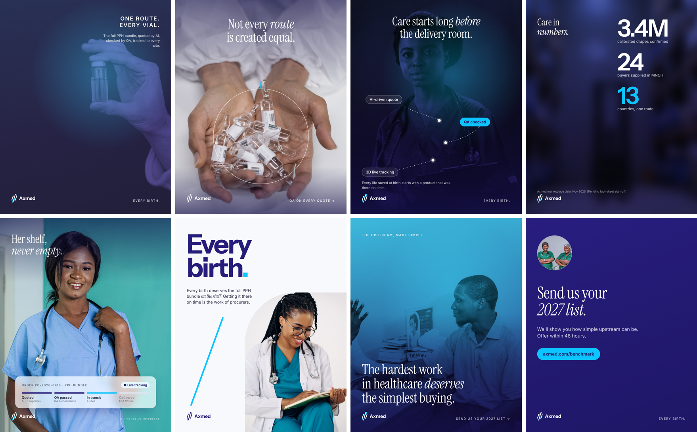
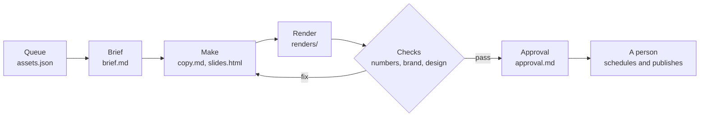
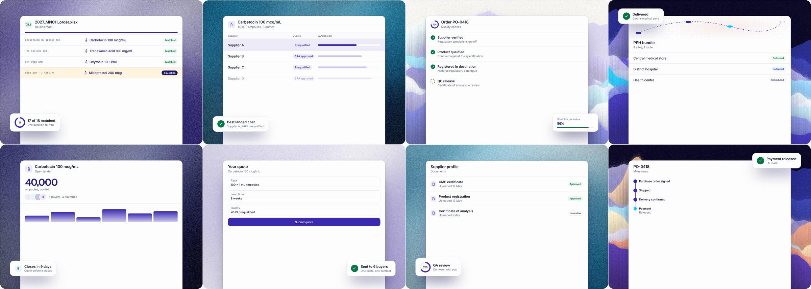
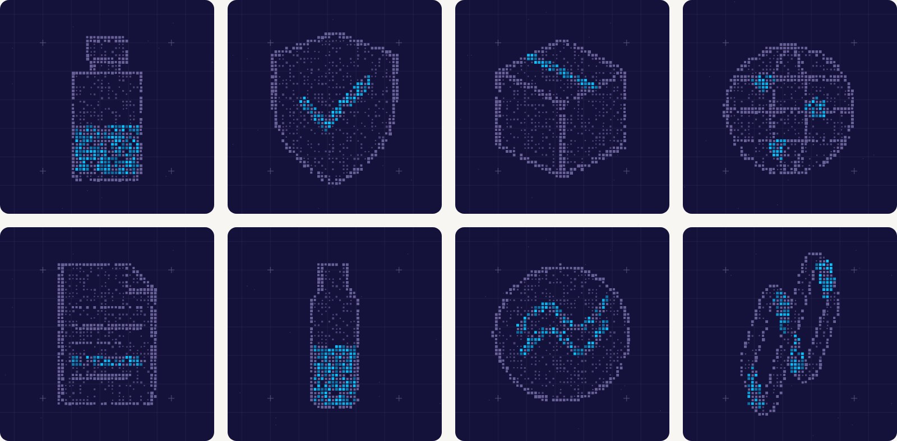
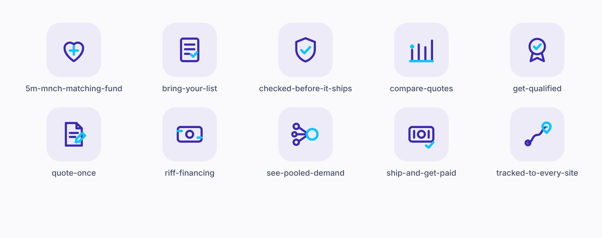
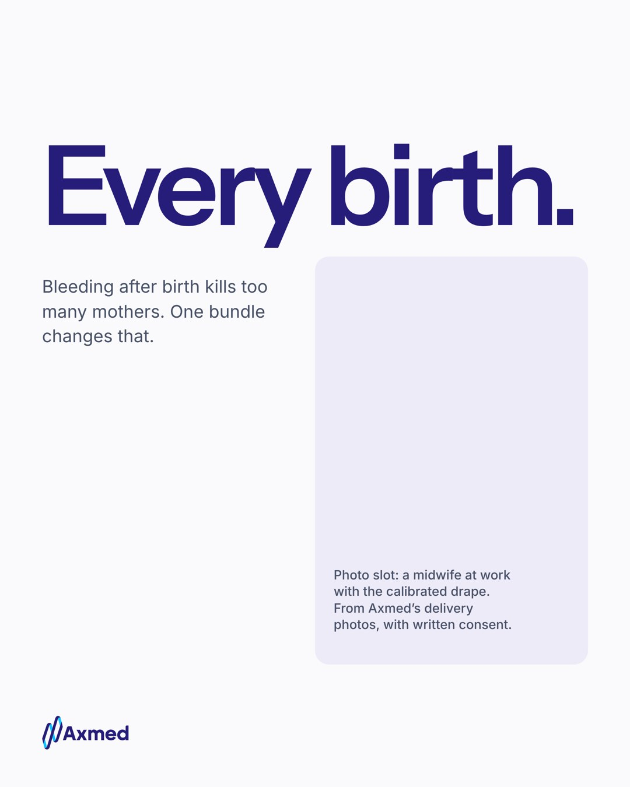

<p align="center">
  <picture>
    <source media="(prefers-color-scheme: dark)" srcset="brand/logo/axmed-logo-white.svg">
    
  </picture>
</p>

<h3 align="center">Axmed marketing</h3>

<p align="center">
  The brand, the strategy and every campaign asset, in one repo that Claude works in.<br>
  Skills know the rules, scripts check the numbers, and people approve what goes out.
</p>

<p align="center">
  <a href="#see-it-first">See it first</a> ·
  <a href="#start-here">Start here</a> ·
  <a href="#set-up">Set up</a> ·
  <a href="#how-an-asset-gets-made">How an asset gets made</a> ·
  <a href="#the-brand-system">Brand system</a> ·
  <a href="#whats-in-progress">In progress</a> ·
  <a href="#the-rules">Rules</a>
</p>

<p align="center">
  
  <br><sub>The photo-led post system (<code>brand/photo-system/</code>). People shown are AI-generated mood imagery, never presented as real partners or patients.</sub>
</p>

---

## What this is

Axmed makes buying medicines simple for health buyers: qualified suppliers, quality checks and delivery to every site,
through one route. This repo is how marketing tells that story without inventing anything along the way.

It holds three things, and Claude works across all of them:

| | What it holds | Where |
|---|---|---|
| **Brand** | Logo, colour, type and motion tokens; the brand kit for web and social; icons, product images, dot-matrix and strata art, photo templates | [`brand/`](brand/) |
| **Strategy** | Positioning, the fact sheet of approved claims, campaign briefs and the asset queue, the brand film research | [`strategy/`](strategy/) |
| **Work** | Campaign assets, the homepage prototype, films | [`content/`](content/), [`site/`](site/), [`video/`](video/) |

Claude reads [`CLAUDE.md`](CLAUDE.md) in every session, so the house rules travel with the repo, not with a person.

## Start here

| I want to… | Open | Or ask Claude |
|---|---|---|
| See the landing page | `npm start`, then <http://localhost:3094> | "Run the site and open the landing page" |
| See the brand at a glance | `npm start`, then <http://localhost:3094/kit> | "Show me the brand kit" |
| Find an asset or a file | [`ASSETS.md`](ASSETS.md) | "Where are the product images?" |
| Make a post, carousel, email or WhatsApp card | The asset's row in the [queue](strategy/campaigns/01-every-birth/asset-plan.md) | "Make A1.5, the PPH bundle carousel" |
| Check a draft before it goes out | `node scripts/check-numbers.mjs <folder> --final` | "Check this post" |
| Work on the website | [`site/index.html`](site/index.html), rules in [`brand/WEB-DESIGN.md`](brand/WEB-DESIGN.md) | "Improve the homepage hero" |
| Pick up the brand film | [`strategy/brand-film/`](strategy/brand-film/) | "Where are we on The List?" |
| Continue in a fresh Claude session | [`START-HERE.md`](START-HERE.md), then [`HANDOFF.md`](HANDOFF.md) | Paste the first message from START-HERE |

## See it first

All you need is [Node](https://nodejs.org) 20 or newer. Nothing to install:

```bash
git clone https://github.com/thisiswahbax/axmed-marketing.git && cd axmed-marketing
npm start
```

Your browser opens the landing page at <http://localhost:3094>. The buyer and supplier pages are at
[`/buy`](http://localhost:3094/buy) and [`/sell`](http://localhost:3094/sell), and the brand kit at
[`/kit`](http://localhost:3094/kit). Press Ctrl+C to stop.

## Set up

To make assets with Claude, you also need [Claude Code](https://claude.com/claude-code) and [uv](https://docs.astral.sh/uv/).
From the repo folder:

```bash
cp .env.example .env             # add your ElevenLabs key and the absolute content path
npm install                      # Playwright, to render slides and cards to PNG and PDF
./scripts/install-skills.sh      # community skills (marketing, Remotion, documents)
claude                           # approve the "elevenlabs" MCP server when asked
```

For voice and music, create an ElevenLabs key with only the text-to-speech, voices, music and sound-effects scopes. For
Higgsfield images and video, add the connector `https://mcp.higgsfield.ai/mcp`, or put a Higgsfield API key in `.env`. Keys stay
out of the repo: `.env` is git-ignored and Claude is denied access to it.

## How an asset gets made

Every asset has an ID (such as `A1.6`), a row in the queue, and its own folder. Agents draft and check; people approve and
press publish.



One folder per asset, with the same file names every time, so people, agents and scripts all find things in the same place:

```
content/01-every-birth/cards/A1.6-impact-card/
  brief.md       audience, one message, CTA, the numbers it may use
  copy.md        caption and message text
  slides.html    the design, built on brand/system.css
  renders/       the PNG, JPG or PDF that gets posted
  review.md      each review round, newest first, with the check output pasted in
  approval.md    who approved which version, and when (people fill this in)
```

The commands that move it along:

```bash
node scripts/assets.mjs due 14                               # what releases in the next two weeks
node scripts/check-numbers.mjs content/01-every-birth/cards/A1.6-impact-card --final
node scripts/assets.mjs status A1.6 in-review "Round 2"      # updates the queue and asset-plan.md
node scripts/assets.mjs check                                # validates every queue
```

`check-numbers` compares every figure and risky phrase with [`strategy/fact-sheet.md`](strategy/fact-sheet.md): a number that
isn't there fails, and so does wording such as "because of" next to a health outcome. Only a person can set an asset to
`approved`, `scheduled` or `live`. The full plan for the agents is in [`PLAN-agents.md`](PLAN-agents.md).

## The brand system

One source of truth, [`brand/system.css`](brand/system.css), feeds the website, the brand kit and every social template. Indigo
leads, cyan is the single accent, Instrument Serif carries headlines, Inter carries the rest.

<table>
  <tr>
    <td width="50%"><br><sub><b>Product images</b> for buyers and suppliers · <a href="brand/product-images/"><code>brand/product-images/</code></a></sub></td>
    <td width="50%"><br><sub><b>Dot-matrix illustrations</b>, animated · <a href="brand/dot-matrix/"><code>brand/dot-matrix/</code></a></sub></td>
  </tr>
  <tr>
    <td width="50%"><br><sub><b>Icons</b>, indigo line with one cyan detail · <a href="brand/icons/"><code>brand/icons/</code></a></sub></td>
    <td width="50%"><br><sub><b>Campaign carousel</b>, A1.5 · <a href="content/01-every-birth/carousel/A1.5-pph-bundle/"><code>carousel/A1.5-pph-bundle/</code></a></sub></td>
  </tr>
</table>

To change a colour or font, edit `brand/system.css`, copy it to `site/system.css`, and rebuild:

```bash
python3 scripts/build-tokens.py && python3 scripts/build-kit.py
```

## What's in progress

| Work | Where it stands | Open |
|---|---|---|
| **Campaign 01, "Every birth."** Act 1 builds the story around the PPH bundle; act 2 invites buyers to send their 2027 list | Status per asset lives in the queue, not here | [`asset-plan.md`](strategy/campaigns/01-every-birth/asset-plan.md) |
| **Homepage** | A static prototype on the brand system | [`site/`](site/), [`HANDOFF.md`](HANDOFF.md) |
| **Brand film, "The List"** "Every line is someone." A procurement officer's messy order line becomes a birth in a district hospital | Research and storyboard done; stills, clips and an animatic in progress | [`strategy/brand-film/`](strategy/brand-film/), [`video/A0.1-the-list/`](video/A0.1-the-list/) |
| **Agents** | Phase 0 done: the queue, the asset folders, the numbers check | [`PLAN-agents.md`](PLAN-agents.md) |

## The rules

These are the short version. [`CLAUDE.md`](CLAUDE.md) and [`brand/brand-guidelines.md`](brand/brand-guidelines.md) have the
full set, and skills and scripts enforce them.

- **No invented numbers.** Every figure comes from [`strategy/fact-sheet.md`](strategy/fact-sheet.md), worded exactly as it says.
  Anything else is `[NUMBER NEEDED]`. Felix signs off every public number.
- **Real people, their own words.** No AI-generated patients, health workers or partners presented as real, no synthetic
  quotes, no cloned voices. Partners approve the final cut of their story.
- **Axmed is the enabler, not the hero.** "Where the bundle was in use", never "because of".
- **Agents never publish.** They draft, check and prepare an approval packet. A person posts, sends and schedules.
- **On brand by construction.** Tokens from `brand/system.css` only, and the Hallmark lint passes before any web work ships.

<details>
<summary><b>Repo map</b></summary>

```
CLAUDE.md                   the rules Claude follows here (worth reading once yourself)
START-HERE.md, HANDOFF.md   how to pick the work up in a new session, and where it stands
ASSETS.md                   index of every brand asset
PLAN-agents.md              the agent plan: roles, pipeline, guardrails, rollout
.claude/skills/axmed-*      Axmed skills: posts, carousels, emails, WhatsApp cards, video briefs, voice-over
.claude/agents/             brand-reviewer, the independent check against the central test
.mcp.json                   the ElevenLabs MCP server
brand/                      guidelines, voice, tokens, logo, kit, icons, imagery systems, moodboard
strategy/                   positioning, fact sheet, claim rules, channels, measures, calendar
  campaigns/<c>/            brief, assets.json (the queue), asset-plan.md (generated)
  brand-film/               reference library, storyboard, Higgsfield prompts and run sheet
  templates/                brief, review, approval, interview guide, case study, consent checklist
content/<campaign>/         assets, one folder per asset as they move through review
site/                       the homepage prototype
video/                      one Remotion project per film
scripts/                    build, render, check and queue scripts (below)
```

</details>

<details>
<summary><b>Scripts</b></summary>

| Script | What it does |
|---|---|
| `serve.mjs` (`npm start`) | Serves the landing page, the buyer and supplier pages, and the brand kit on localhost; no install |
| `assets.mjs` | The asset queue: `table`, `status`, `due`, `check`, `show` |
| `check-numbers.mjs` | Checks every number and risky phrase against the fact sheet; `--final` also fails open placeholders |
| `render-carousel.mjs` | Renders each slide of an HTML file to PNG, plus one PDF |
| `render-all.sh`, `build-assets.py` | Rebuild and re-render the campaign cards and carousels |
| `build-tokens.py`, `build-kit.py` | Regenerate the tokens and the brand kit page from `brand/system.css` |
| `build-side-pages.py` | Rebuild the site's buyer and supplier pages |
| `utm.mjs` | Build a UTM-tagged link for an asset |
| `make-*.py`, `treat-photo.py`, `export-dotmatrix.mjs` | Generate backgrounds, patterns, terrain, product cards, illustrations, photo treatments, dot-matrix exports |

</details>

<details>
<summary><b>Skills</b></summary>

Our own skills win when they disagree with a community skill.

| Ask Claude | Skill |
|---|---|
| "Write the A1.2 launch post for Felix" | `axmed-linkedin-post` |
| "Build A1.5, the PPH bundle in 5 slides" | `axmed-carousel` |
| "Draft story email 1 for the funders track" | `axmed-email` |
| "Make the Benchmark Challenge WhatsApp card" | `axmed-whatsapp-card` |
| "Turn the LifeNet interview into all the assets" | `axmed-asset-multiplier` |
| "Brief the bundle explainer film" | `axmed-video-brief` |
| "Make the voice-over for the bundle explainer" | `axmed-voiceover` (ElevenLabs) |
| "Make the A2.1 proof film" | `axmed-product-video` plugin and the Remotion skills |
| "Check this post" | `axmed-brand-check` and the `brand-reviewer` agent |

| Community pack | Why |
|---|---|
| [`coreyhaines31/marketingskills`](https://github.com/coreyhaines31/marketingskills) | Copywriting, social content, email sequences, launch strategy |
| [`remotion-dev/skills`](https://www.remotion.dev/skills) | Remotion best practices for video code |
| [`anthropics/skills`](https://github.com/anthropics/skills) | pptx, docx, pdf and xlsx for one-pagers, case studies and decks |
| [`elevenlabs/elevenlabs-mcp`](https://github.com/elevenlabs/elevenlabs-mcp) | Text-to-speech, voice design, music, sound effects, transcription |

</details>
