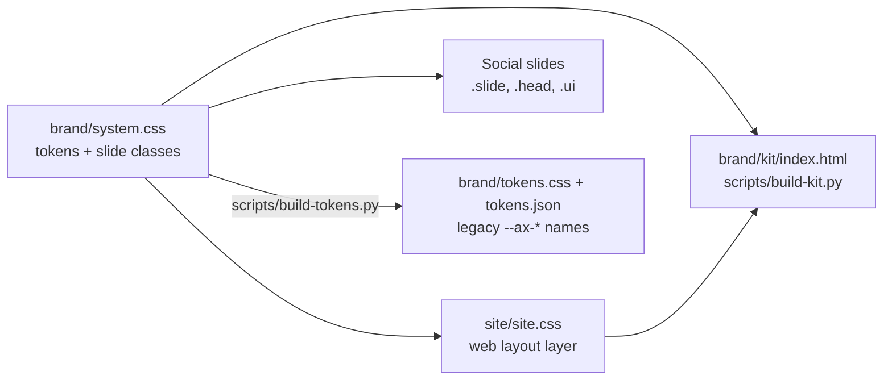

# Axmed brand kit

One set of rules for web pages and social posts. Open `brand/kit/index.html` from a local server at the
repo root (the page loads `brand/system.css` and `site/site.css`, so opening the file directly won't
load everything):

```bash
python3 -m http.server 3095 --directory .
```

Then go to http://localhost:3095/brand/kit/

## What's in it

| Section | What it shows |
|---|---|
| Start here | How to set up a web page and a social slide from the same token file |
| Logo | Lockup, mark and one-colour versions, with clear space and minimum size |
| Colour | Every token, read live from `brand/system.css`, with its job. Click a token name to copy it |
| Type | The three families and what each is for. Headlines are two-tone, never italic or all caps |
| Motion | Duration and easing tokens, with a button to play each one |
| Web components | Buttons, status pills, product details and a live product shot from `site/site.css` |
| Social formats | Four live `.slide` examples (statement, figure, product, Sina) and the format sizes |
| Imagery | Icons, backgrounds, strata, patterns, illustrations, dot-matrix, product images, mood photos |
| Rules | We do / we never, and the checklist before anything goes out |

## One source of truth



- **Change a colour, font or timing in `brand/system.css` only.** Copy it to `site/system.css`
  (the two stay identical), then run:

  ```bash
  python3 scripts/build-tokens.py && python3 scripts/build-kit.py
  ```

- `brand/tokens.css` and `brand/tokens.json` are generated. They keep the older `--ax-*` names working
  for the carousel template and `brand/photo-system/`, now with the current values. Don't edit them by
  hand.
- `brand/kit/index.html` is generated too. To change the page, edit `scripts/build-kit.py` (content)
  or `brand/kit/kit.css` (kit layout). New files in the brand folders appear in the imagery galleries
  the next time the script runs.

## Using it

**A web page.** Link `system.css` then `site.css`, build from the classes on the kit page, and follow
`brand/WEB-DESIGN.md`. Lint before handing over:

```bash
node .claude/skills/hallmark/scripts/sloplint.mjs site/system.css site/site.css site/index.html --genre modern-minimal
```

**A social post.** Link `brand/system.css`, start from `.slide` (1080 × 1350) or `.slide.sq`
(1080 × 1080), and place children absolutely. Render with `node scripts/render-carousel.mjs`.

Voice, creative rules and approvals are in `brand/brand-guidelines.md`.
